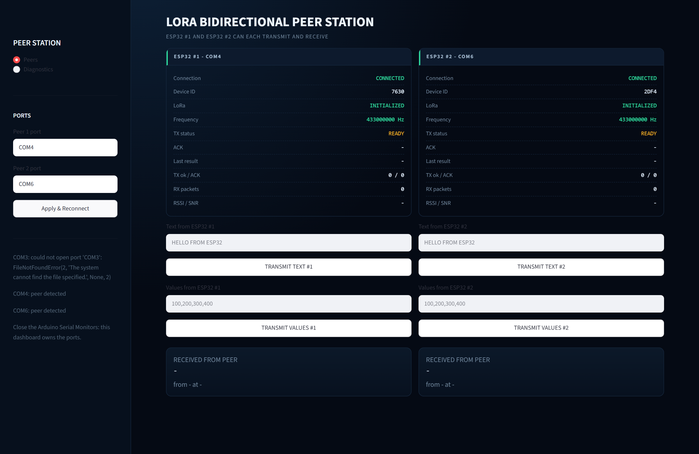
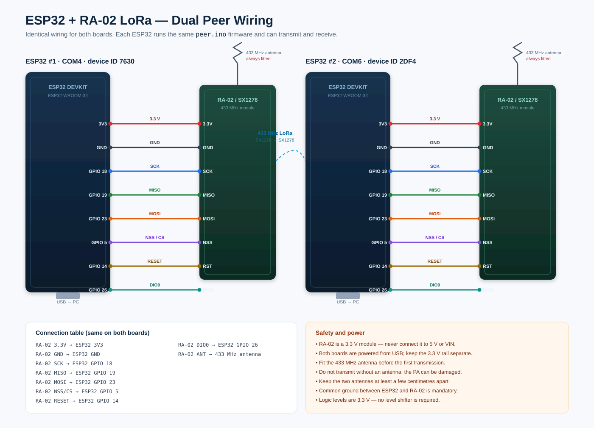
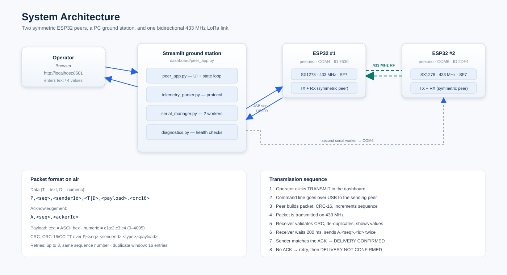
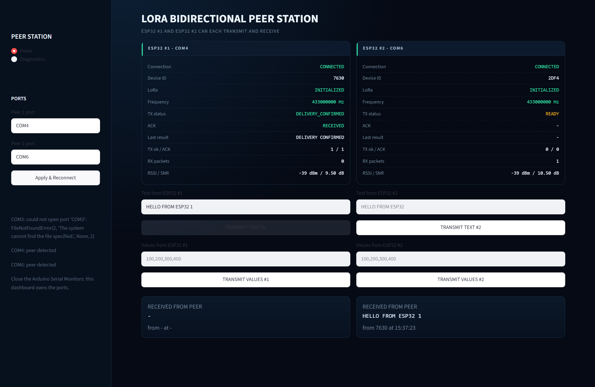
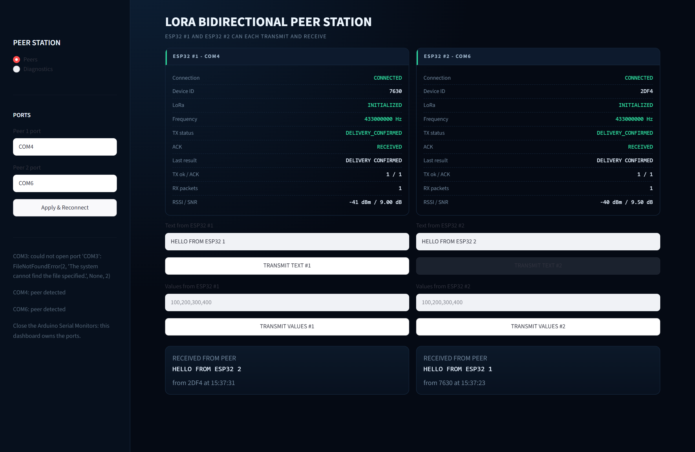
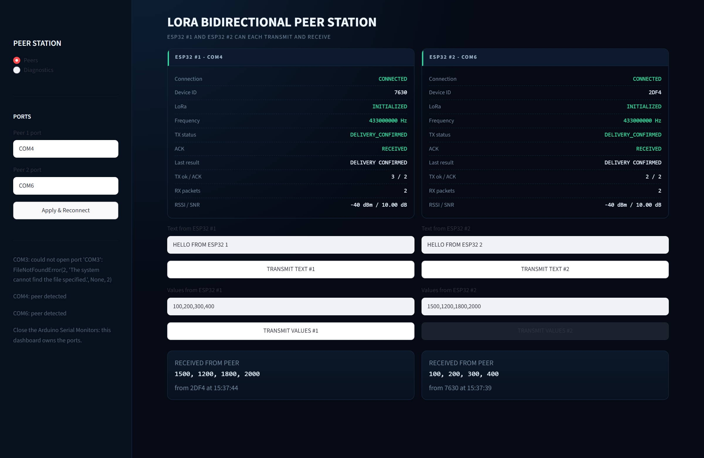
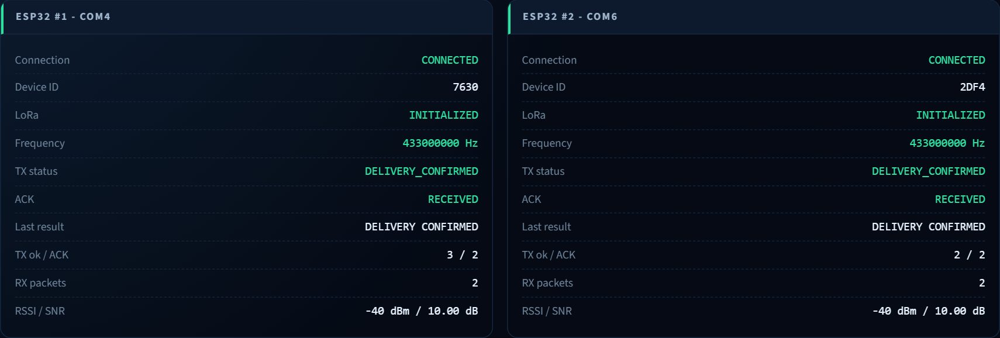
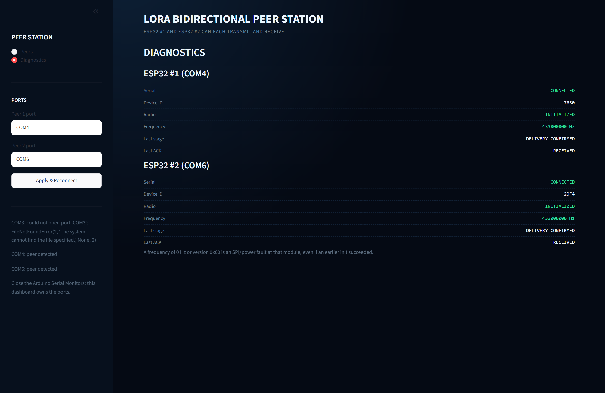

# ESP32-Based Bidirectional LoRa Communication and Ground Station

Two ESP32 development boards talking to each other over 433 MHz with SX1278
(RA-02) LoRa modules — **both boards can send and receive** — with a Streamlit
ground station that displays every real packet, RSSI, SNR and acknowledgement.



---

## Table of contents

- [Overview](#overview)
- [What actually works](#what-actually-works)
- [Working demonstration](#working-demonstration)
- [Features](#features)
- [Hardware requirements](#hardware-requirements)
- [Wiring connections](#wiring-connections)
- [System architecture](#system-architecture)
- [LoRa configuration](#lora-configuration)
- [Repository layout](#repository-layout)
- [Software installation](#software-installation)
- [Firmware upload](#firmware-upload)
- [Dashboard startup](#dashboard-startup)
- [Communication testing](#communication-testing)
- [Actual screenshots](#actual-screenshots)
- [Verified test results](#verified-test-results)
- [Troubleshooting](#troubleshooting)
- [Limitations](#limitations)
- [Future improvements](#future-improvements)

---

## Overview

This project is a complete, working peer-to-peer LoRa link:

- **Two ESP32 boards** (ESP32-WROOM-32 DevKit) each carry one **RA-02 / SX1278**
  LoRa transceiver on the **433 MHz** band.
- Both boards run the **same firmware** (`peer/peer.ino`). There is no fixed
  transmitter and no fixed receiver — each board is a full peer that transmits
  and receives.
- A message or four numeric values is typed into the **Streamlit ground
  station**; the firmware of the selected peer builds a packet, transmits it,
  and waits for a matching acknowledgement from the other peer.
- The receiving peer validates the packet, displays it in the dashboard, and
  sends the acknowledgement back. Only then is **DELIVERY CONFIRMED** shown.

Every value displayed by the dashboard comes from a real LoRa packet on real
hardware. There is no joystick input, no ADC channel, no random data generator
and no simulated telemetry anywhere in the project.

### Hardware used for the verified run

| Item | Value |
|---|---|
| Board A | ESP32-WROOM-32 DevKit — device ID **7630** |
| Board B | ESP32-WROOM-32 DevKit — device ID **2DF4** |
| Radio | 2 × RA-02 SX1278, 433 MHz, version register `0x12` |
| Antenna | 433 MHz matched antenna on each module |
| PC | Windows, Python 3.12, Streamlit |

Device IDs are derived from the ESP32 MAC address, so they stay stable for a
given board and cannot be forged by a firmware role setting.

COM port numbers are assigned by Windows and **change when a board is
re-plugged**, so they are not part of the design. During development the pair
appeared as `COM4`/`COM6`, and after a re-enumeration as `COM4`/`COM5`. The
dashboard detects both peers automatically and the firmware never hard-codes a
port.

---

## What actually works

| Capability | Status | Evidence |
|---|---|---|
| Text message, ESP32 #1 → ESP32 #2 | Working | received and displayed |
| Text message, ESP32 #2 → ESP32 #1 | Working | received and displayed |
| Four numeric values, both directions | Working | values received unchanged |
| Sequence numbers | Working | persisted in NVS, incremented per packet |
| CRC-16 validation | Working | invalid packets rejected with `RXERR` |
| Acknowledgement (ACK) round trip | Working | matching `A,<seq>,<id>` decoded |
| Retransmission (3 attempts) | Working | same sequence reused |
| Duplicate detection | Working | `dup=1`, ACK re-sent, not re-counted |
| RSSI / SNR reporting | Working | real radio measurements per packet |
| Streamlit ground station | Working | live view of both peers |
| Diagnostics page | Working | radio version, frequency, state |

---

## Working demonstration

### Text message

Type a message in the **ESP32 #1** panel and press **TRANSMIT TEXT #1**:

```text
HELLO FROM ESP32 1
```

The packet leaves ESP32 #1 on 433 MHz. ESP32 #2 receives it, shows
`RECEIVED FROM PEER: HELLO FROM ESP32 1`, and replies with an ACK. ESP32 #1
then displays `DELIVERY CONFIRMED`.

Typing into the **ESP32 #2** panel works exactly the same way in reverse:

```text
HELLO FROM ESP32 2
```

### Numerical data

Four values, range `0..4095`, comma separated:

```text
100,200,300,400
```

The other peer receives `100, 200, 300, 400`. Reverse direction:

```text
1500,1200,1800,2000
```

Both directions were executed on the hardware and captured in
[screenshots](#actual-screenshots).

---

## Features

- **Symmetric peers** — one firmware, both boards transmit and receive.
- **Manual text transmission** — 1 to 40 printable ASCII characters.
- **Manual numeric transmission** — exactly four values, `0..4095`.
- **Real-time packet reception** — live over USB serial at 115200 baud.
- **Sequence numbers** — monotonic per sender, stored in NVS across reboots.
- **CRC-16 (CCITT)** — every packet carries a checksum over its body.
- **Acknowledgement mechanism** — `A,<seq>,<ackerId>`, sent twice for
  robustness after a 200 ms settle delay.
- **Retransmission** — up to 3 attempts with the same sequence number.
- **Duplicate detection** — a 16-entry ring of `(sender, sequence)` pairs.
- **RSSI and SNR monitoring** — read from the SX1278 for each received packet.
- **Delivery truth** — `DELIVERY CONFIRMED` is emitted only after a matching ACK
  is decoded; otherwise `DELIVERY NOT CONFIRMED`.
- **Diagnostics** — SX1278 version register, tuned frequency, operating mode,
  radio re-initialisation counters.

---

## Hardware requirements

| Quantity | Component |
|---:|---|
| 2 | ESP32-WROOM-32 DevKit development boards |
| 2 | RA-02 / SX1278 LoRa modules, **433 MHz** |
| 2 | 433 MHz antennas (SMA or IPEX with pigtail) |
| 2 | Micro-USB data cables |
| 1 | PC with two free USB ports |
| — | Jumper wires (female-to-female) |
| — | 2 × breadboards (optional) |

**Power:** both boards are powered over USB. The RA-02 is a **3.3 V** device and
is powered from the ESP32 `3V3` pin. Do not feed the module from `5V` or `VIN`.

---

## Wiring connections

Both boards are wired identically.

| RA-02 LoRa pin | ESP32 pin | Wire colour in diagram |
|---|---|---|
| 3.3V | 3V3 | red |
| GND | GND | black |
| SCK | GPIO 18 | blue |
| MISO | GPIO 19 | green |
| MOSI | GPIO 23 | orange |
| NSS / CS | GPIO 5 | violet |
| RESET | GPIO 14 | amber |
| DIO0 | GPIO 26 | teal |
| ANT | 433 MHz antenna | — |



> The SVG is at [`docs/wiring_diagram.svg`](docs/wiring_diagram.svg) and opens in
> any browser. It is a vector drawing, so it stays sharp at any zoom level.

### Power supply

- ESP32: 5 V over USB (on-board regulator).
- RA-02: **3.3 V only**, from the ESP32 `3V3` pin.
- Typical RA-02 current: ~120 mA peak while transmitting. The ESP32 3.3 V
  regulator on a DevKit handles this, but keep the USB cable short and of good
  quality.
- If you power the boards from an external supply, the ESP32 and RA-02 must share
  a common ground.

### Antenna

- Fit a **433 MHz** antenna to every module **before** the first transmission.
- Never transmit with the antenna disconnected — the PA output stage can be
  damaged.
- Keep the two antennas a few centimetres apart; very close spacing (under ~1 cm)
  can desensitise the receivers.

### Safety precautions

- **RA-02 must use 3.3 V, never 5 V.** 5 V on the module destroys it.
- Double-check the SPI wiring before powering up; a swapped `3V3`/`GND` will
  destroy the module.
- ESP32 GPIOs are 3.3 V logic — RA-02 is 3.3 V logic, so no level shifter is
  needed and none should be added.
- Do not hot-plug the module while the board is powered.
- Respect local radio regulations for the 433 MHz band and the permitted
  transmit power (this firmware uses 2 dBm).

---

## System architecture



### Peer architecture

There is **one firmware image** and it is flashed identically to both boards.
At boot each board:

1. Derives a 4-character device ID from the ESP32 MAC address (`7630`, `2DF4`).
2. Initialises the RA-02 over SPI, checks the version register (`0x12`), tunes to
   433 MHz and enables CRC.
3. Enters receive mode and prints `PEERREADY,id=...,radio=OK,freq=433000000,...`.
4. Accepts commands from USB serial **and** simultaneously receives LoRa packets.

### Why both boards can transmit and receive

The radio is half duplex, so the firmware handles the transition explicitly:

- **Before transmitting**, the radio is verified to be tuned (`ensureTuned`).
- **After transmitting**, the sender waits a **50 ms guard** and a 5 ms settle,
  then enters RX and listens for the ACK for 1800 ms.
- **On reception**, the receiver validates the packet, replies with an ACK,
  then returns to RX.
- A watchdog re-arms the radio if it ever leaves a valid RX state (`0x85`
  continuous or `0x86` single are both accepted).

That post-TX guard and the receiver's 200 ms pre-ACK delay are what make the ACK
round trip reliable; without them the ACK can complete before the sender's
receiver is ready.

### Packet structure

Data packet on air:

```text
P,<seq>,<senderId>,<T|D>,<payload>,<crc16>
```

| Field | Example | Meaning |
|---|---|---|
| `P` | `P` | packet type marker |
| `seq` | `13` | sequence number, decimal |
| `senderId` | `7630` | 4 hex characters derived from MAC |
| `type` | `T` / `D` | text / numeric |
| `payload` | `48454C4C4F` / `100;200;300;400` | ASCII hex for text, semicolon list for numbers |
| `crc16` | `A1F3` | CRC-16/CCITT over everything before it |

Acknowledgement:

```text
A,<seq>,<ackerId>
```

Example: `A,13,2DF4` — peer `2DF4` acknowledges sequence `13`.

### Sequence numbers

- One counter per device, incremented once per new logical packet.
- Persisted in NVS through `Preferences`, so it survives a reboot.
- Retries of the same packet **reuse** the same sequence number, which is how the
  receiver recognises them as duplicates.

### CRC validation

`crc16()` implements CRC-16/CCITT (poly `0x1021`, init `0xFFFF`) over the packet
body. A mismatch is rejected and counted:

```text
RXERR,reason=crc,rssi=-52,snr=9.25,ms=...
```

### ACK transmission and reception

Receiver side (`sendAck`):

1. Wait **200 ms** so the sender has finished its TX → RX switch.
2. Build `A,<seq>,<deviceId>`.
3. Transmit it, wait for `TxDone`, then transmit the **same ACK a second time**
   120 ms later (belt and braces; a duplicate ACK is harmless).
4. Return to RX.

Sender side (`waitForAck`):

1. 50 ms post-TX guard, then enter RX.
2. Parse packets; log every raw ACK as `ACKRAW`.
3. Accept only an ACK whose sequence matches the packet just sent (`ACKMATCH`);
   anything else is logged as `ACKREJECT`.

### Retry mechanism

Up to 3 attempts per packet, each with an 1800 ms ACK window. The final state is:

| Condition | Stage |
|---|---|
| Matching ACK received | `DELIVERY_CONFIRMED` |
| Packet transmitted, no ACK | `DELIVERY_NOT_CONFIRMED` |
| Radio could not transmit | `TRANSMISSION_FAILED` |

### Dashboard ↔ serial communication

`dashboard/serial_manager.py` opens each COM port once and runs a reader thread
per port. Lines are pushed into a queue; `peer_app.py` drains that queue on every
Streamlit rerun (0.6 s), parses the machine-readable lines and redraws the panels.
The dashboard **owns the ports** — the Arduino Serial Monitor must be closed.

Commands are written back over the same serial link:

| Dashboard action | Serial command |
|---|---|
| Transmit text | `TEXT,<message>` |
| Transmit values | `DATA,<c1>,<c2>,<c3>,<c4>` |

### Received data parsing and display

Machine lines produced by the firmware and consumed by the dashboard:

```text
PEERREADY,id=7630,radio=OK,freq=433000000,sf=7,sync=0x12,seq=10
TXBEGIN,seq=13,id=7630,type=D,text=-,c1=100,c2=200,c3=300,c4=400,packet=...
TXSTAGE,seq=13,stage=DELIVERY_CONFIRMED,attempts=1,tx=OK,ack=OK,ms=3772
RXPKT,seq=13,from=7630,type=D,dup=0,rssi=-50,snr=9.50,ack=OK,c1=100,...,ms=4053
ACKRAW,len=9,payload="A,13,2DF4",rssi=-57,snr=9.50
ACKMATCH,seq=13,payload="A,13,2DF4"
RXERR,reason=crc,rssi=-52,snr=9.25,ms=...
```

A real received numeric packet renders as:

```text
RECEIVED FROM PEER
100, 200, 300, 400
from 7630 at 15:03:40
```

---

## LoRa configuration

| Parameter | Value |
|---|---|
| Frequency | 433 000 000 Hz |
| Spreading factor | SF7 |
| Bandwidth | 125 kHz |
| Coding rate | 4/5 |
| Sync word | `0x12` (private network) |
| CRC | enabled (hardware) |
| Preamble | 8 symbols |
| TX power | 2 dBm |
| SPI | SCK 18, MISO 19, MOSI 23, NSS 5 |
| Control | RESET 14, DIO0 26 |

Both peers must use identical radio settings; they are compiled into the single
firmware, so flashing the same sketch to both boards guarantees a match.

---

## Repository layout

```text
LoRa_Ground_Station/
├── peer/
│   └── peer.ino                  # the firmware — flash to BOTH boards
├── dashboard/
│   ├── peer_app.py               # Streamlit UI (Peers + Diagnostics)
│   ├── serial_manager.py         # port detection + reconnecting readers
│   ├── telemetry_parser.py       # protocol parser / state
│   └── diagnostics.py            # health checks and recommendations
├── tests/
│   └── peer_diag.py              # 5× STATUS probe + bidirectional RF test
├── tools/
│   └── capture_screenshots.py    # regenerates docs/screenshots from the live app
├── config/
│   ├── settings.json             # active dashboard settings
│   └── settings.example.json     # reference copy
├── docs/
│   ├── wiring_diagram.svg        # both boards, both modules, every wire
│   ├── architecture.svg          # system + protocol diagram
│   ├── TEST_RESULTS.md           # captured serial evidence
│   └── screenshots/              # genuine screenshots of the running app
├── start_dashboard.bat
├── requirements.txt
└── README.md
```

---

## Software installation

Requirements: Python 3.10+ and the Arduino IDE (or `arduino-cli`) with the
**esp32** board package and the **LoRa** library by Sandeep Mistry.

```powershell
cd C:\Users\USER\Documents\Arduino\LoRa_Ground_Station
python -m pip install -r requirements.txt
```

`requirements.txt`:

```text
pyserial>=3.5
streamlit>=1.40
```

Optional, only to regenerate screenshots:

```powershell
python -m pip install playwright
python -m playwright install chromium
```

---

## Firmware upload

The firmware is the same for both boards, so compile once and flash twice.

### Arduino IDE

1. Install **esp32 by Espressif Systems** in Boards Manager.
2. Install **LoRa by Sandeep Mistry** in Library Manager.
3. Open `peer/peer.ino`.
4. Select board **ESP32 Dev Module**, upload speed 921600, and the correct port.
5. Upload. Repeat for the second board on its port.

### arduino-cli

```powershell
$cli = "$env:LOCALAPPDATA\Programs\Arduino IDE\resources\app\lib\backend\resources\arduino-cli.exe"

& $cli compile --fqbn esp32:esp32:esp32 --build-path "$env:TEMP\peer_build" `
    "C:\Users\USER\Documents\Arduino\LoRa_Ground_Station\peer"

& $cli upload -p COM4 --fqbn esp32:esp32:esp32 --input-dir "$env:TEMP\peer_build"
& $cli upload -p COM6 --fqbn esp32:esp32:esp32 --input-dir "$env:TEMP\peer_build"
```

Expected serial output after reset (115200 baud):

```text
PEERREADY,id=7630,radio=OK,freq=433000000,sf=7,sync=0x12,seq=10
```

---

## Dashboard startup

```powershell
python -m streamlit run dashboard/peer_app.py
```

or double-click `start_dashboard.bat`, then open
<http://localhost:8501>.

The dashboard auto-detects both peer boards. If detection misses one, type the
port in **Peer 1 port** / **Peer 2 port** in the sidebar and click
**Apply & Reconnect**.

> **Only one program may own a COM port.** Close the Arduino Serial Monitor before
> starting the dashboard, and do not run the diagnostic script while the
> dashboard is open.

---

## Communication testing

### From the dashboard

1. Confirm both peer panels show `CONNECTED` and `LoRa INITIALIZED`.
2. Enter a message under **ESP32 #1** and press **TRANSMIT TEXT #1**.
3. The right panel shows `RECEIVED FROM PEER` with the text, and the left panel
   shows `DELIVERY CONFIRMED` and `ACK RECEIVED`.
4. Repeat in the opposite direction.
5. Enter `100,200,300,400` under **ESP32 #1** and press **TRANSMIT VALUES #1**.

### From the command line

```powershell
cd C:\Users\USER\Documents\Arduino\LoRa_Ground_Station
python tests\peer_diag.py --p1 COM4 --p2 COM6          # status only
python tests\peer_diag.py --p1 COM4 --p2 COM6 --test   # real RF + ACK test
```

The first command collects five consecutive `STATUS` readings from both boards.
The second performs a genuine bidirectional transmission and reports the ACK
result of each direction.

### From the serial monitor

Open the peer's port at 115200 baud with **Newline** line endings:

| Command | Action |
|---|---|
| `TEXT,HELLO FROM ESP32 1` | send text |
| `DATA,100,200,300,400` | send four values |
| `STATUS` | full diagnostics |
| `HELP` | command list |

---

## Actual screenshots

All images below were captured from the live application at
<http://localhost:8501> with both ESP32 boards connected. They are genuine
screenshots of real LoRa traffic — nothing is mocked or retouched.

### Dashboard overview — both peers connected


### Bidirectional text — ESP32 #1 to ESP32 #2



### Reverse direction — ESP32 #2 to ESP32 #1



### Numerical values — both directions



### Acknowledgement and delivery confirmation



### Diagnostics — real SX1278 hardware status



---

## Verified test results

Captured from the boards on 2026-11-17 after the ACK timing fix. Full logs are in
[`docs/TEST_RESULTS.md`](docs/TEST_RESULTS.md). Two runs are recorded: the first
with the ports Windows assigned as `COM4`/`COM6`, and a re-verification after
the boards re-enumerated to `COM4`/`COM5`.

### Hardware identification

| Reading | COM4 (7630) | COM6 (2DF4) |
|---|---|---|
| SX1278 version ×5 | `0x12` ×5 | `0x12` ×5 |
| Frequency ×5 | `433000000` ×5 | `433000000` ×5 |
| OPMODE | `0x86` (RX_SINGLE, normal) | `0x86` |

### Text, both directions

```text
COM4 -> COM6: TEXT,ACK FIX TEST A TO B
  ACKRAW,len=9,payload="A,12,2DF4",rssi=-57,snr=9.75
  ACKMATCH,seq=12,payload="A,12,2DF4"
  TXSTAGE,seq=12,stage=ACK_RECEIVED,attempt=1
  TXSTAGE,seq=12,stage=DELIVERY_CONFIRMED,attempts=1,tx=OK,ack=OK
  RXPKT,seq=12,from=7630,type=T,dup=0,rssi=-51,snr=9.75,ack=OK

COM6 -> COM4: TEXT,ACK FIX TEST B TO A
  ACKRAW,len=9,payload="A,11,7630",rssi=-54,snr=9.50
  ACKMATCH,seq=11,payload="A,11,7630"
  TXSTAGE,seq=11,stage=DELIVERY_CONFIRMED,attempts=1,tx=OK,ack=OK
  RXPKT,seq=11,from=2DF4,type=T,dup=0,rssi=-51,snr=9.75,ack=OK
```

### Numeric data, both directions

```text
COM4 -> COM6: DATA,100,200,300,400
  ACKMATCH,seq=13,payload="A,13,2DF4"
  TXSTAGE,seq=13,stage=DELIVERY_CONFIRMED,attempts=1,tx=OK,ack=OK
  RXPKT,seq=13,from=7630,type=D,dup=0,rssi=-50,snr=9.50,ack=OK,c1=100,c2=200,c3=300,c4=400

COM6 -> COM4: DATA,1500,1200,1800,2000
  ACKMATCH,seq=12,payload="A,12,7630"
  TXSTAGE,seq=12,stage=DELIVERY_CONFIRMED,attempts=1,tx=OK,ack=OK
  RXPKT,seq=12,from=2DF4,type=D,dup=0,rssi=-52,snr=9.25,ack=OK,c1=1500,c2=1200,c3=1800,c4=2000
```

| Check | COM4 → COM6 | COM6 → COM4 |
|---|---|---|
| Matching ACK | yes, attempt 1 | yes, attempt 1 |
| Delivery | confirmed | confirmed |
| Data RSSI | −50 … −51 dBm | −51 … −52 dBm |
| Data SNR | 9.50 dB | 9.25 … 9.75 dB |

### Re-verification after USB re-enumeration

The same two boards after Windows re-assigned the ports (`COM4` = **2DF4**,
`COM5` = **7630**), using `tests/peer_diag.py --p1 COM4 --p2 COM5 --test`:

```text
COM4 (2DF4) -> COM5 (7630)
  TXSTAGE,seq=29,stage=ACK_RECEIVED,attempt=1,rssi=-51,snr=9.25
  TXSTAGE,seq=29,stage=DELIVERY_CONFIRMED,attempts=1,tx=OK,ack=OK
  ACKTX,seq=29,from=7630,attempt=1,begin=1,txdone=1
  RXPKT,seq=29,from=2DF4,type=T,dup=0,rssi=-45,snr=10.00,ack=OK

COM5 (7630) -> COM4 (2DF4)
  TXSTAGE,seq=33,stage=ACK_RECEIVED,attempt=1,rssi=-48,snr=10.00
  TXSTAGE,seq=33,stage=DELIVERY_CONFIRMED,attempts=1,tx=OK,ack=OK
  ACKTX,seq=33,from=2DF4,attempt=1,begin=1,txdone=1
  RXPKT,seq=33,from=7630,type=T,dup=0,rssi=-44,snr=10.25,ack=OK
```

| Check | 2DF4 → 7630 | 7630 → 2DF4 |
|---|---|---|
| Matching ACK | yes, attempt 1 | yes, attempt 1 |
| Delivery | confirmed | confirmed |
| RSSI / SNR | −45 dBm / 10.00 dB | −44 dBm / 10.25 dB |

This confirms the result does not depend on which USB port a board lands on.


---

## Troubleshooting

| Symptom | Likely cause | Fix |
|---|---|---|
| Dashboard shows `OFFLINE` | port busy or wrong port | close Serial Monitor, set port manually, Apply & Reconnect |
| `SX1278 version 0x00` / `freq 0 Hz` | SPI or power fault | check 3.3 V, GND, SCK/MISO/MOSI/NSS, RESET wiring; reseat the module |
| `ACK_TIMEOUT`, `DELIVERY NOT CONFIRMED` | other peer off, antenna, or distance | power the other peer, fit antennas, reduce distance |
| `ACKREJECT` | ACK for a different sequence | stale ACK from an earlier packet; retry |
| `RXERR,reason=crc` | corrupted RF packet | normal at range edges; retransmission handles it |
| `dup=1` | retry received twice | expected behaviour, ACK is re-sent automatically |
| Only one peer detected | other board has old firmware | flash `peer/peer.ino` to both boards |
| `PermissionError` on write | two programs own the port | close the dashboard or the Serial Monitor |

---

## Limitations

- Half-duplex: a peer cannot transmit while it is receiving.
- Text is limited to **40** printable ASCII characters per packet.
- Numeric payload is exactly **four** values in `0..4095`.
- Duplicate detection remembers the last **16** `(sender, sequence)` pairs.
- No encryption or authentication — the link is a private sync-word network, not
  a secure channel.
- RSSI/SNR accuracy depends on the SX1278 and module shielding; treat it as an
  indication, not a calibrated measurement.
- Software cannot detect a disconnected antenna or a damaged PA if the SPI
  registers still answer; that requires physical inspection.

---

## Future improvements

- Optional AES-based payload encryption and per-device keys.
- Variable-length numeric payloads and signed values.
- Packet history persisted to SQLite with CSV export.
- Timestamped logging with a monotonic packet counter per session.
- Automatic frequency/SF fallback on repeated ACK timeouts.
- A third peer and addressed unicast (`to=<id>`).
- Battery-powered peer with deep-sleep reporting.

---

## Notes

- This repository contains the working system only. The superseded
  fixed-role `transmitter.ino` / `receiver.ino` design is archived locally and
  intentionally not published, so the code here matches what runs on the boards.
- No credentials, API keys, virtual environments or build artefacts are
  committed to this repository.
- Firmware and dashboard behaviour described here was observed on real hardware.
